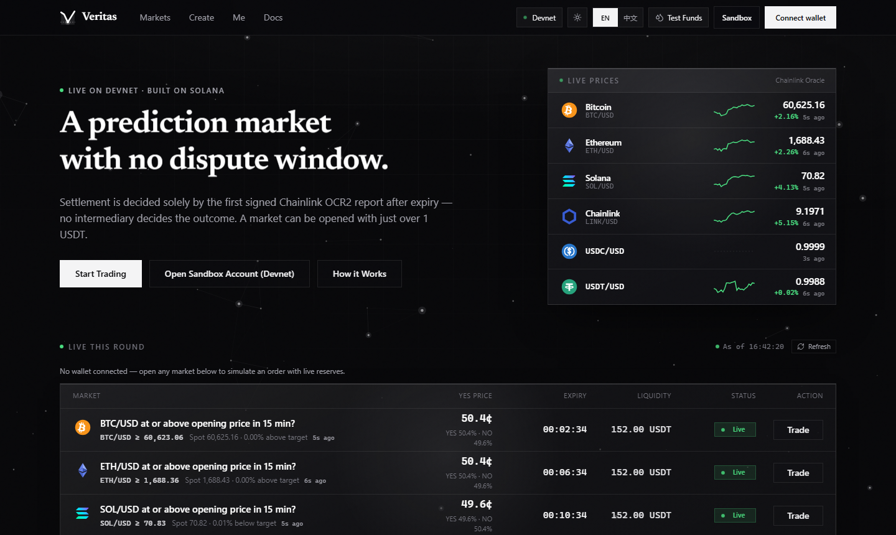

# Veritas Markets

[](https://github.com/Zephyr-110/Veritas/actions/workflows/contract-tests.yml)
[](https://github.com/Zephyr-110/Veritas/actions/workflows/frontend-tests.yml)
[](https://explorer.solana.com/address/CYVpaizqcMaoqPfBaMABPAH3xpPaC6iCuWiViXjeHuER?cluster=devnet)
[](LICENSE)

**1-Minute Verification**
- **Live Devnet Sandbox:** [Open Veritas on Solana Devnet](https://veritas.zephyr110.com/)
- **Live Settlement Proof:** [`5d5FcdpyBHcibizcMP3CEgcWEWRQVruvh8QhGQGVq9FPevfbGno4fDjM2KVhpbuVsavrZRud8PCqJaeiBzeg6uzp`](https://explorer.solana.com/tx/5d5FcdpyBHcibizcMP3CEgcWEWRQVruvh8QhGQGVq9FPevfbGno4fDjM2KVhpbuVsavrZRud8PCqJaeiBzeg6uzp?cluster=devnet) — first live proof of primary-track adjacent-round (`epoch/round`) settlement.
- Across six Devnet Chainlink OCR2 feeds, **172,714 reports** landed on November 22, 2026 (UTC). The round sequence jumped **24 times**. When a jump straddles market expiry, a matching on-chain snapshot can certify the two reports for settlement. [Census, transaction signatures and replay instructions](docs/oracle-census-2026-11-22.md)



A non-custodial binary prediction market on Solana. Pricing follows a dynamic [pm-AMM](https://www.paradigm.xyz/2024/11/pm-amms) invariant, settlement is verified directly on-chain against signed **Chainlink OCR2** oracle reports (with a permissionless expiry snapshot backstop), and every circulating YES/NO complete set is backed 1:1 by collateral in the market vault.

No off-chain matching engine, no admin resolver, and no trusted relayer — the browser client (`app/`) talks directly to Solana RPC.

| Component | Details |
| :--- | :--- |
| **Program ID (Devnet)** | [`CYVpaizqcMaoqPfBaMABPAH3xpPaC6iCuWiViXjeHuER`](https://explorer.solana.com/address/CYVpaizqcMaoqPfBaMABPAH3xpPaC6iCuWiViXjeHuER?cluster=devnet) |
| **Collateral Mint (Devnet USDT)** | [`CtiAxpKmXtK2bupa59GN6GPYXQiPPYUfSqnY1pgMD7QG`](https://explorer.solana.com/address/CtiAxpKmXtK2bupa59GN6GPYXQiPPYUfSqnY1pgMD7QG?cluster=devnet) |
| **Chainlink OCR2 Program** | [`cjg3oHmg9uuPsP8D6g29NWvhySJkdYdAo9D25PRbKXJ`](https://explorer.solana.com/address/cjg3oHmg9uuPsP8D6g29NWvhySJkdYdAo9D25PRbKXJ?cluster=devnet) |
| **Chainlink Store Program** | [`HEvSKofvBgfaexv23kMabbYqxasxU3mQ4ibBMEmJWHny`](https://explorer.solana.com/address/HEvSKofvBgfaexv23kMabbYqxasxU3mQ4ibBMEmJWHny?cluster=devnet) |
| **Tech Stack** | Rust 1.89 · Anchor · Solana · Chainlink OCR2 · Next.js 15 · Vitest · LiteSVM |

**Why Solana.** A market's full lifecycle here — create, seed, expiry snapshot, settle — has to cost almost nothing, because the seed floor is a little over 1 USDT. Expiry snapshots land inside a ±10-second window around expiry, and a complete on-chain settlement (secp256k1 verification of the signed Chainlink OCR2 report) consumes 118k–130k compute units; the whole lifecycle costs a fraction of a cent in fees. Placing a bet (user_bet_on) consumes roughly 540,000–560,000 compute units per transaction, measured on devnet (roughly 600,000 CU on a new wallet's first bet when creating associated token accounts). At EVM gas prices the fees alone would consume a substantial share of a 1 USDT pool, and sub-second slots are what make a ±10-second snapshot window practical.

---

## Core Design

### 1. Complete-Set Backing
Depositing 1 unit of collateral mints 1 YES and 1 NO token. Burning 1 YES and 1 NO returns 1 unit of collateral. The vault balance always equals the exact complete-set liability in circulation (`vault == yes_supply == no_supply` while open).

### 2. Time-Decaying pm-AMM
Instead of a static constant-product curve, the pool uses the pm-AMM invariant (Moallemi & Robinson) with time-decaying effective liquidity:

$$L_{\text{eff}} = L_0 \sqrt{T - t}$$

As expiry $T$ approaches, effective pool depth shrinks smoothly and released inventory accrues to LPs via per-share cumulative checkpoints (`cum_yes_per_share`, `cum_no_per_share`). Swaps apply a **dynamic per-leg fee** starting at **0.50% (50 bps)** when a market opens and rising toward **3.00% (300 bps)** as expiry approaches — anchored on the 15-minute market (shorter markets climb faster, longer markets slower) — accruing 100% to active LPs with zero protocol take.

### 3. Trustless Chainlink OCR2 Settlement & Snapshot Backstop
Every market binds to an allowlisted Chainlink OCR2 `State` account (`decimals == 8`), a target `threshold`, a comparison direction (`settle_above`), and an expiry (`end_ts`).

After expiry, anyone can submit two raw Chainlink OCR2 `transmit` payloads (`pre` and `post`) to `resolve_market`:
- **On-chain authenticity**: Verifies `secp256k1` oracle signatures ($f + 1$ distinct signers in the on-chain sorted oracle roster) and matches `latest_config_digest`.
- **Straddling & continuity**: Proves `pre.observations_timestamp < end_ts <= post.observations_timestamp`, and requires `pre` and `post` to be either:
  1. **Adjacent OCR2 rounds** (`round + 1` in the same epoch, or `(e, r_max) -> (e + 1, 1)` where `r_max` is parsed from `offchain_config`), **or**
  2. **Snapshot-certified**: Certified by two consecutive entries (`next.counter == prev.counter + 1`) recorded in the market's `MarketSnapshot` PDA via `take_snapshot` when Chainlink rounds skip across expiry.
- **Outcomes**:
  - `post` lands within the on-chain post-expiry tolerance (`MAX_SETTLE_DELAY = 10` seconds, `post.ts <= end_ts + 10`) → **`Resolved`**: winning side redeems 1:1; `settled_price` and `settled_publish_time` are stored on-chain.
  - `post` lands past the 10-second tolerance (`post.ts > end_ts + 10`) → **`StaleBurn`**: stale pricing is discarded; both YES and NO redeem at $\lfloor \text{amount} / 2 \rfloor$.
  - No resolution within **48 hours** of expiry → anyone can call `void_market` → **`WindowBurn`**: same $\lfloor \text{amount} / 2 \rfloor$ redemption.

### 4. Claim Window & Account Cleanup
Traders and LPs have **30 days** (`CLAIM_WINDOW`) after `finish_ts` to redeem tokens or withdraw LP shares. Once the claim window expires, the market creator can call `burn_account` to sweep remaining vault collateral, burn pool remnants, and close the `Market`, `MarketSnapshot`, vault, and pool accounts.

```text
create_market (creates Market + MarketSnapshot PDAs, binds OCR2 State)
      │
      ▼
    Open ──── user_bet_on / swap / add_liquidity / get_liquidity / merge_token
      │
      ├── (end_ts - 10s, end_ts + 10s) ──► take_snapshot (records up to 16 feed landings)
      │
      │  expiry (end_ts)
      ▼
  48h Resolve Window
      ├── resolve_market ──► Resolved   (post <= end_ts + 10s; winner redeems 1:1)
      │                  └─► StaleBurn  (post >  end_ts + 10s; both sides redeem 1/2)
      │
      └── void_market ─────► WindowBurn (after 48h timeout; both sides redeem 1/2)
                                │
                                │  30-day claim window (finish_ts + CLAIM_WINDOW)
                                ▼
                           burn_account (creator closes Market & Snapshot, sweeps dust)
```

---

## Instructions

| Instruction | Access | Description |
| :--- | :--- | :--- |
| `create_market` | Anyone | Open a market, bind an allowlisted OCR2 `State`, allocate `MarketSnapshot`, and seed initial LP liquidity (`> 1` collateral). |
| `user_bet_on` | Anyone | Deposit collateral, mint a complete YES/NO pair, and swap the unwanted side into the target outcome. |
| `swap` | Anyone | Trade YES ↔ NO directly against the pm-AMM pool. |
| `add_liquidity` | Anyone | Deposit collateral as a complete set and receive pro-rata LP shares. |
| `get_liquidity` | LP | Withdraw pro-rata pool reserves plus accrued pending YES/NO balances; full exit closes `LpPosition`. |
| `merge_token` | Anyone | Burn equal YES + NO amounts to redeem collateral 1:1 while the market is `Open`. |
| `take_snapshot` | Anyone | Record the feed's `(epoch, round, counter, price, ts)` into `MarketSnapshot` within `±10s` of `end_ts` (max 16 entries, monotonic `counter`). |
| `resolve_market` | Anyone | Verify two straddling OCR2 `transmit` reports (adjacent rounds or snapshot-certified) to resolve or `StaleBurn`. |
| `void_market` | Anyone | Transition an unresolved `Open` market to `WindowBurn` after the 48h resolve window closes. |
| `get_collateral` | Anyone | Redeem winning tokens 1:1 in `Resolved`, or either token at `floor(amount / 2)` in `StaleBurn` / `WindowBurn`. |
| `burn_account` | Creator | After the 30-day claim window, sweep leftover collateral, burn pool tokens, and close `Market`, `MarketSnapshot`, vault, and pools. |

---

## On-Chain Constants & Allowlisted Feeds

### Constants

| Constant | Value | Meaning |
| :--- | :--- | :--- |
| `SERVICE_FEE` (base) | `50` bps | Per-leg swap fee when a market opens |
| `FEE_INCREMENTAL` | `250` bps | Additional per-leg fee reached at expiry (total cap 300 bps) |
| `FEE_ANCHOR_DURATION_SEC` | `900` s | The duration the fee climb is anchored on; shorter markets climb faster, longer ones slower, endpoints unchanged |
| `RESOLVE_WINDOW` | `172,800` s | 48-hour post-expiry window for permissionless `resolve_market`. |
| `MAX_SETTLE_DELAY` | `10` s | On-chain protocol constant (requires a program upgrade to change) for post-expiry delay before triggering `StaleBurn`. |
| `SNAPSHOT_WINDOW` | `±10` s | Open window `(end_ts - 10, end_ts + 10)` for `take_snapshot`. |
| `SNAPSHOT_MAX_ENTRIES` | `16` | Maximum number of snapshot entries stored per market. |
| `CLAIM_WINDOW` | `2,592,000` s | 30-day redemption window after `finish_ts` before `burn_account`. |
| Minimum Seed | `1,000,001` units | Strict `> 1` unit minimum collateral (assuming 6 decimals). |

### Allowlisted Chainlink Devnet Feeds (`ALLOWED_FEEDS`)

| Pair | Decimals | OCR2 State (`ocr2_state`) | Store Transmissions (`feed`) |
| :--- | :---: | :--- | :--- |
| **BTC/USD** | 8 | `HCKJKQ8xFfqm5BxTA6LaUCWYXNShYXF4eAwC7NhBYXkj` | `6PxBx93S8x3tno1TsFZwT5VqP8drrRCbCXygEXYNkFJe` |
| **ETH/USD** | 8 | `7zDTDDXiMqwbEEE17ZuFE4A6K5uBQo15tG1gkgdKZQB2` | `669U43LNHx7LsVj95uYksnhXUfWKDsdzVqev3V4Jpw3P` |
| **SOL/USD** | 8 | `EpFp9mhi9cvZL9Lp59S1mt2twv2dtZGgFUvZEQMZ9Ra8` | `99B2bTijsU6f1GCT73HmdR7HCFFjGMBcPZY6jZ96ynrR` |
| **LINK/USD** | 8 | `Ghm1a2c2NGPg6pKGG3PP1GLAuJkHm1RKMPqqJwPM7JpJ` | `HXoZZBWv25N4fm2vfSKnHXTeDJ31qaAcWZe3ZKeM6dQv` |
| **USDC/USD** | 8 | `ENVhPWE3nuvwc5qx2MjSwS41SXr33gFgGaWX4ATA9pyV` | `2EmfL3MqL3YHABudGNmajjCpR13NNEn9Y4LWxbDm6SwR` |
| **USDT/USD** | 8 | `DcZuU19fXJSEurnuFh4moeYK5hohvgaBD5KmjvHvYEG1` | `8QQSUPtdRTboa4bKyMftVNRfGFsB4Vp9d7r39hGKi53e` |

---

## Repository Layout

```text
Veritas/
├── programs/prediction_market/
│   ├── src/
│   │   ├── lib.rs                 # Anchor program entrypoints (11 instructions)
│   │   ├── constants.rs           # Windows, fees, and ALLOWED_FEEDS table
│   │   ├── entity.rs              # Market, LpPosition, MarketSnapshot, Snapshot, EpochRound
│   │   ├── state.rs               # MarketStatus & MarketOutcome enums
│   │   ├── error.rs               # Custom Anchor error codes
│   │   ├── instructions/          # One module per instruction
│   │   └── math/                  # pm_math, accrual (I80F48), lut, ocr2 (verify_report & read_r_max)
│   └── tests/                     # LiteSVM integration, econ-security, and captured OCR2 suites
├── oracle/                        # Python pm-AMM math & protocol simulator reference vectors
├── docs/                          # Full-day Devnet Chainlink OCR2 census & verification data
├── app/                           # Next.js 15 frontend client & Vitest suite (see app/README.md)
├── scripts/                       # Permissionless settle.js CLI, SQLite indexer, Devnet deploy, and faucet scripts
│   └── sandbox/                   # Keeper tick.js, daily.js, settle-all.js, expiry-watch.js & tests
└── .github/workflows/             # CI pipelines (contract-tests.yml & frontend-tests.yml)
```

### Program PDAs

- `["market", market_id]` — `Market` state account
- `["snapshot", market]` — `MarketSnapshot` backstop account
- `["yes_mint", market]` / `["no_mint", market]` — Outcome token mints
- `["yes_pool", market]` / `["no_pool", market]` — AMM pool token accounts
- `["collateral_vault", market]` — Market collateral vault
- `["lp_position", market, owner]` — Per-LP share and checkpoint account

---

## Build & Test

### 1. On-Chain Program & LiteSVM Suite

Requires **Rust 1.89.0**, **Solana CLI (`cargo-build-sbf`)**, **Anchor**, and **Python 3** with `pip install -r oracle/requirements.txt` (for `oracle/protocol_sim.py` cross-checks).

```bash
# Build the SBF program binary (required by LiteSVM tests)
cargo build-sbf --arch v0

# Run the full contract test net (lib math + spec_scenarios + econ_settlement + ocr2_settle)
npm test
# equivalent to:
cargo test -p prediction_market --lib --test spec_scenarios --test econ_settlement --test ocr2_settle -- --test-threads=1

# Run math unit tests only (no .so build required)
cargo test --manifest-path programs/prediction_market/Cargo.toml --lib
```

See [programs/prediction_market/tests/README.md](programs/prediction_market/tests/README.md) and [SCENARIO_REPORT.md](programs/prediction_market/tests/SCENARIO_REPORT.md) for invariants, accounting drift caps, and captured Chainlink fixture details.

### 2. Frontend Client & Vitest Suite

```bash
cd app
npm install
cp .env.example .env.local   # optional; defaults target Solana Devnet

npm run dev                  # start Next.js dev server on http://localhost:3000
npm run typecheck            # TypeScript check (tsc --noEmit)
npm run lint                 # ESLint check (eslint .)
npm run test:coverage        # Run all 44 Vitest suites (390 tests + 4 opt-in devnet checks) with v8 coverage gates
```

From the repository root, `scripts/` also includes **6 `node --test` suites** (`scripts/settle.test.js`, `scripts/db.test.js`, and `scripts/sandbox/*.test.js`).

The default public Devnet RPC is rate-limited. For local development, set `NEXT_PUBLIC_SOLANA_RPC` in `app/.env.local` to your own Devnet RPC endpoint.

The client IDL under `app/src/idl/` is generated via `npm run gen-idl` (from `app/`, or `node app/scripts/gen-idl.js`). Further frontend details live in [app/README.md](app/README.md).

### 3. Continuous Integration

- [`.github/workflows/contract-tests.yml`](.github/workflows/contract-tests.yml) — Builds the SBF binary (`release.anza.xyz/stable`) and executes the full Cargo + LiteSVM test net (`--lib`, `spec_scenarios`, `econ_settlement`, `ocr2_settle`).
- [`.github/workflows/frontend-tests.yml`](.github/workflows/frontend-tests.yml) — Runs on Node 24 with `npm run typecheck`, `npm run lint`, `npm run test:coverage` with enforced coverage gates, plus the 6 `node --test` script suites.

---

## Known Limitations

- **Oracle configuration rotation.** Settlement verifies both straddling reports against the bound `ocr2_state` account's live `latest_config_digest` and oracle roster at settlement time. If a feed's configuration rotates before expiry, reports signed under the new configuration continue to settle normally; however, if rotation occurs across expiry or before `resolve_market` executes, straddling reports signed under the superseded configuration fail `OracleDigestMismatch`, and the market voids after the 48-hour window with a 0.5 refund. By design, configuration drift can only ever produce a void, never a wrong winner.
- **Collateral scope.** Markets accept standard SPL Token mints only; Token-2022 mints are rejected at creation so transfer-tax and hook extensions stay out of the vault accounting. The seed floor (strictly more than 1,000,000 smallest units) assumes a 6-decimal stablecoin; the contract does not enforce mint decimals or a minimum market duration.
- **Bet transaction compute units.** On Devnet, `user_bet_on` measures roughly 540,000–560,000 CU per transaction (around 600,000 CU on a new wallet's first bet when associated token accounts are created in the same transaction). Compute optimization is scoped for the mainnet release.
- **Verbose program logs.** The deployed Devnet binary contains several debug-style `msg!` log lines (such as separator banners in `user_bet_on`). Stripping verbose logs is scoped for the mainnet cleanup.

---

## Acknowledgments & Attribution

- **pm-AMM Invariant**: Liquidity pricing, dynamic time-decay scaling ($L_{\text{eff}} = L_0\sqrt{T - t}$), and LVR intuition build on Paradigm's pm-AMM research paper by **Ciamac Moallemi & Dan Robinson (2024)** — [pm-AMMs](https://www.paradigm.xyz/2024/11/pm-amms).
- **Chainlink Solana Infrastructure**: Price feeds and oracle reports rely on **Chainlink** official open-source Solana OCR2 & Store programs and Devnet Data Feeds. On settlement, the smart contract **directly verifies signed OCR2 reports** on-chain (`secp256k1` oracle multi-signatures, config digest, and report bytes) without any trusted intermediary.
- **Original Veritas Implementation**: Veritas's core state machine (`Open` → `Resolved` / `StaleBurn` / `WindowBurn` + 30-day claim and cleanup lifecycle), the permissionless adjacent-report-number settlement engine (straddling round continuity checks, rollover across epochs via `r_max`, and failed-transaction payload extraction), and the `MarketSnapshot` monotonic-counter witness backstop (`take_snapshot`) are original to this project.

---

## License

Licensed under the [MIT License](LICENSE).

